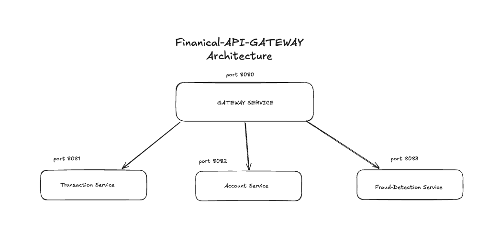
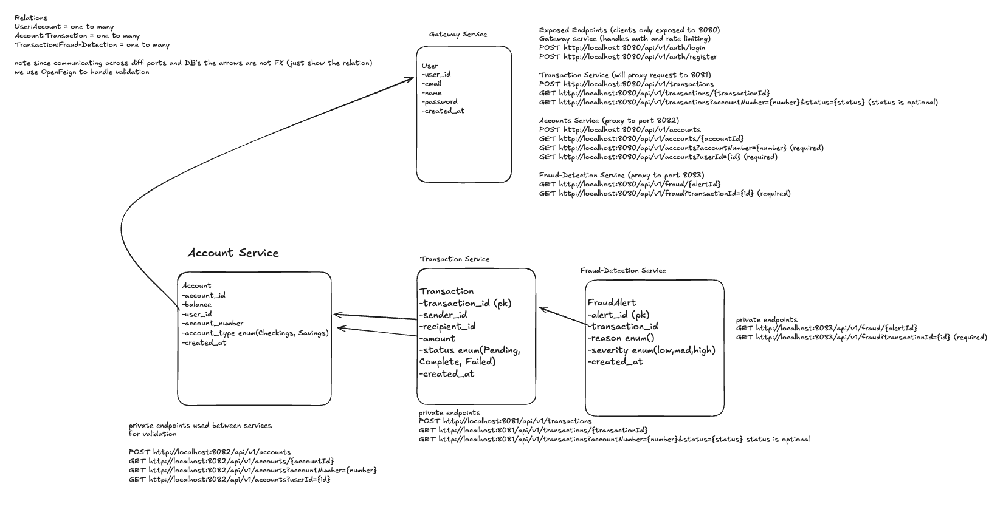
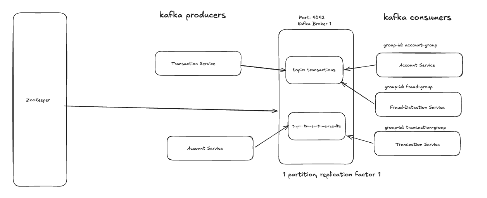

# Financial API Gateway

A microservices-based financial transaction platform demonstrating distributed systems patterns: API gateway routing, event-driven processing with Kafka, JWT authentication, distributed rate limiting, and rule-based fraud detection.

Built as a portfolio project to demonstrate backend architecture and distributed systems design. 
Took inspiration after completing J.P. Morgan simulation and decided to expand on it. This project mimics person-to-person transfers (e.g Cash App) compared to full traditional banking

## Table of Contents
- [Overview](#overview)
- [Architecture](#architecture)
- [Tech Stack](#tech-stack)
- [Getting Started](#getting-started)
- [Testing](#testing)
- [Logging](#logging)
- [Performance & Metrics](#performance--metrics)
- [Current Limitations](#current-limitations)

## Overview

This project simulates a financial transaction system split across four independently deployable services, communicating both synchronously (REST via Feign) and asynchronously (events via Kafka). A client interacts only with a single API Gateway, which handles authentication, rate limiting, and request routing to the appropriate downstream service.

Core flow: a client creates a transaction → the Transaction Service validates the sender/recipient accounts and balance via Feign → the transaction is saved as `PENDING` and a Kafka event is published → the Account Service consumes the event and updates balances → the Fraud Service independently consumes the same event and evaluates fraud rules → the Account Service publishes a result event → the Transaction Service consumes the result and updates the transaction's final status.

## Architecture







**Request flow (synchronous):**
```
Client → Gateway (rate limit filter → JWT auth filter → routing) → downstream service
```

**Transaction flow (asynchronous, event-driven):**
```
POST /transactions → Transaction Service validates via Feign → saves PENDING
    → publishes TransactionEvent to "transactions" topic
        → Account Service consumes (group: account-group) → updates balances
            → publishes TransactionResultEvent to "transactions-results" topic
                → Transaction Service consumes (group: transaction-group) → updates status
        → Fraud Service consumes (group: fraud-group) → evaluates fraud rules
            → creates FraudAlert if flagged (no result published back)
```

Each consumer group reads the same topic independently (Account Service and Fraud Service both receive every transaction event, but are responsible for different things)

## Tech Stack

- **Backend:** Spring Boot, Spring Cloud Gateway, Spring WebFlux
- **Messaging:** Apache Kafka
- **Caching / Rate Limiting:** Redis, Bucket4j
- **Database:** PostgreSQL 
- **Inter-service Communication:** OpenFeign
- **Authentication:** JWT (JJWT)
- **Testing:** JUnit 5, Mockito, k6
- **Infrastructure:** Docker

## Getting Started

### Prerequisites
- Docker & Docker Compose
- (Optional, for local development outside Docker) Java 21, Maven

### Running locally

```bash
git clone <repo-url>
cd financial-api-gateway
```

Each service requires its own `.env.local` file (not committed to source control). See `.env.example` in each service folder for required variables (database connection, Kafka bootstrap servers, JWT secret, Redis host).

Start the full stack from the project root:

```bash
docker compose up --build
```

This starts all four services, four PostgreSQL instances, Redis, Kafka, and Zookeeper on a shared Docker network.

### Verifying it's running

```bash
# Register a user
curl -X POST http://localhost:8080/api/v1/auth/register \
  -H "Content-Type: application/json" \
  -d '{"email":"alice@test.com","password":"password123","name":"Alice"}'

# Login
curl -X POST http://localhost:8080/api/v1/auth/login \
  -H "Content-Type: application/json" \
  -d '{"email":"alice@test.com","password":"password123"}'
```

Use the returned JWT as a `Bearer` token for all subsequent requests.

**Note:** For testing/demo purposes MUST fund account via direct SQL. (see [Current Limitations](#current-limitations)).

## Testing

Unit tests focus on business logic with real branching/decision paths, rather than pass-through CRUD:

- **Fraud detection rules** — large amount, high balance percentage, unusual frequency, severity classification, idempotency
- **Account balance validation** — insufficient balance handling, account-not-found handling, successful balance updates
- **Transaction validation** — Feign-based account/balance checks, status update handling
- **JWT generation/validation** — token round-trip, expired token rejection
- **Reactive authentication flow** — login/register tested with Reactor's `StepVerifier`
- **Rate limiting** — token bucket allow/reject behavior

Run tests per service:
```bash
cd <service>   # accountservice | fraudservice | transactionservice | gatewayservice
./mvnw test
```

Tests don't need Docker. Each service's `contextLoads` test runs with the `test` profile (`src/test/resources/application-test.yaml`), which swaps in an in-memory H2 database, an embedded Kafka broker, a mocked Redis rate limiter (gateway) and a dummy JWT secret. When a test fails, the full `Caused by:` chain is printed to the console and saved in `target/surefire-reports/`.

## Logging

Services log through SLF4J (Lombok's `@Slf4j`), and **Log4j2** writes the output. This is the Java counterpart of .NET's `ILogger<T>`. Each service's `log4j2.component.properties` sets `AsyncLoggerContextSelector`, so every logger is async: messages go onto an LMAX Disruptor ring buffer and request threads don't wait on log I/O. Spring Boot's default Logback is excluded from `spring-boot-starter`, and also from `spring-kafka-test` (ZooKeeper pulls it in), so the two backends can't clash on the classpath.

Messages use `{}` placeholders, and errors pass the exception as the last argument so the stack trace is kept:

```java
log.info("Fraud alert created transactionId={} reason={} severity={}", id, reason, severity);
log.error("Error sending transaction event transactionId={}", id, ex);
```

### Logging philosophy

- **Log the start.** Every entry point (controller, service method, Kafka listener or producer) logs a `DEBUG` line with its identifiers when it starts, e.g. `Creating account userId=…` or `Producing transaction event transactionId=… topic=…`. Reactive code in the gateway does this in `doOnSubscribe`.
- **Log errors where they happen.** `WARN` is for expected, handled failures (not found, insufficient balance, login failed). `ERROR` is for faults that need attention (a Kafka send failed, or a record went to the DLT). Each failure is logged once, with its identifiers, at the point where it's detected.
- **Implicit returns.** Nothing logs "done", "sent" or "returned". If a start line has no `WARN`/`ERROR` after it, the operation succeeded. This keeps the success path quiet and cuts log volume.
- **Exception: business state changes** log one `INFO` line as an audit trail: `Transaction processed`, `Transaction updated`, `Fraud alert created`, `User registered`, `User logged in`.

```java
log.debug("Getting account accountId={}", accountId);           // start
Account account = accountRepository.findById(accountId).orElseThrow(() -> {
    log.warn("Account not found accountId={}", accountId);      // error
    return new AccountNotFoundException("account not found");
});
return mapToResponse(account);                                  // implicit return: no success log
```

| Level | Used for | Example |
|---|---|---|
| `DEBUG` | Start of an operation | `Creating transaction`, `Received transaction event transactionId=…` |
| `INFO` | Business state changes | `Transaction processed transactionId=… status=COMPLETE` |
| `WARN` | Expected failure, handled | `Account not found accountId=…`, `Insufficient balance for transactionId=…`, `Delivery attempt 2 failed for key=… (RuntimeException)`, `JWT rejected: ExpiredJwtException`, `Rate limit exceeded ip=…` |
| `ERROR` | Failed, needs attention | `Sending key=… to transactions-dlt after RuntimeException` |

Each `GlobalExceptionHandler` only maps exceptions to responses (404 not found, 409 already exists) and doesn't log. The service has already logged the `WARN` before throwing, so the handler doesn't log the failure a second time.

**Sensitive data:** logs carry identifiers only (`transactionId`, `alertId`, `userId`), plus enums and exception class names. They never include:
- Event or DTO objects. They're Lombok `@Data`, so `toString()` prints account numbers, amounts, and the plaintext password in `LoginUserDto`/`RegisterUserDto`.
- Passwords, JWTs or the `Authorization` header, emails, account numbers, amounts or balances.
- `FeignException` messages, which embed the downstream response body.
- Output from loggers that dump data: Hikari `DEBUG` (pool config), `org.hibernate.orm.jdbc.bind` `TRACE` (SQL bind values), Feign `loggerLevel: FULL` (headers and bodies).

App logs default to `INFO`. To turn on debug output for one service, add `logging.level.com.financialapigateway=DEBUG` to its `.env.local`, or set `LOGGING_LEVEL_COM_FINANCIALAPIGATEWAY=DEBUG` in the container's environment. Because start lines are `DEBUG`, this is how you trace a request step by step. The `test` profile already runs app code at `DEBUG`.

Framework logging is turned down so app logs stay readable. `org.apache.kafka` and `org.hibernate` are set to `WARN`, which hides the client config dumps and startup banners but keeps real problems. `spring.jpa.show-sql` is `false`, because it prints straight to stdout and log levels can't hide it. To see the generated SQL while debugging a query, add `LOGGING_LEVEL_ORG_HIBERNATE_SQL=DEBUG` to that service's `.env.local` and restart it.

## Performance & Metrics

**Load testing (k6)**: `POST /api/v1/transactions`, sent through the gateway (rate limiter, JWT auth, routing, account lookups, DB insert, Kafka publish). k6 used constant arrival rates (an open model), so the req/s numbers are real throughput. Setup and commands are in [`loadtests/README.md`](loadtests/README.md).

| Test | Requests | Throughput | p50 | p95 | p99 | Errors |
|---|---|---|---|---|---|---|
| Load: fixed 200 req/s for 2 min | 24,001 | 199.8 req/s | 4.2 ms | 25.8 ms | 67.6 ms | 0% |
| Stress: ramp 25 → 400 req/s over 5 min | 57,741 | peak 400 req/s | 4.4 ms | 29.8 ms | 88.7 ms | 0% |

- At the 200 req/s level, every pass/fail rule passed: no dropped requests, p95 < 300 ms, p99 < 800 ms, and fewer than 1% errors.
- In the stress run, 8 of 57,750 scheduled requests (0.01%) were dropped near the 400 req/s peak, because k6 had no free virtual user at that moment.
- The async pipeline keeps up at 200 req/s: Kafka consumer lag stayed near 0. At 400 req/s, the Fraud Service falls behind (about 24k events of lag by the end) while the API's response times stay the same.

How the numbers were captured:
- Everything ran on one machine: an Apple M3 with 8 GB RAM. The full stack (4 services, Kafka, Zookeeper, Redis, 4 PostgreSQL instances) ran in Docker Desktop with 8 CPUs and about 4 GB of memory, and k6 ran on the same machine.
- Every run started from a clean database, after a 30-second warm-up.
- The `docker-compose.loadtest.yml` override was used. It raises the per-IP rate limit, because k6 sends everything from one IP (the limiter still runs on every request). It also sets INFO logging and caps JVM heaps.

Changes that made these numbers possible:
- **Rate limiter:** each IP's Bucket4j bucket is now reused with request batching. Before, concurrent requests from the same IP raced on one Redis key with compare-and-swap and retried dozens of times per request.
- **Gateway filters:** the rate-limit and JWT filters each ran twice per request, because they were registered both globally and in the security chain. They now run once.
- **JWT:** the gateway authenticates from a `role` claim in the signed token instead of querying the database on every request, and verifies the token once instead of twice.
- **Fraud check:** the "unusual frequency" rule uses an indexed count of the sender's transactions in the time window (`GET /api/v1/transactions/count`). Before, it downloaded the account's entire transaction history on every event.
- **Transaction creation:** the sender and recipient lookups run at the same time, over pooled HTTP connections (`feign-hc5`).

**Kafka end-to-end latency** — measured from event publish (Transaction Service) to balance update completion (Account Service), single-transaction trials:

| Condition | Latency |
|---|---|
| Cold start (first request after `docker compose up`) | ~1.8s |
| Steady-state average (post-warm-up) | ~492ms |

The async pipeline introduces no latency to the client-facing API response — transactions return immediately as `PENDING`. The measured latency reflects how quickly the system reaches a consistent state (balance updated, fraud evaluated) afterward, not how long the client waits.

## Current Limitations

- **Ownership-based authorization not fully enforced.** JWT authentication and role claims (USER/ADMIN) are implemented, but endpoint-level authorization currently relies on the client supplying correct path variables/query params rather than the backend verifying the authenticated user owns the requested resource (e.g., account, transaction). A production version would inject the authenticated `userId` from the JWT as a header at the gateway and verify resource ownership in each downstream service before returning data.

- **No deposit/withdrawal flow.** The system is scoped to person-to-person transfers between existing funded accounts (Cash App-style), not traditional banking with external funding sources. Account funding for testing is done via direct database seeding rather than an API endpoint, by design.

- **Fraud detection is rule-based, not ML-based.** Three simple rules (large absolute amount, high percentage of sender balance, unusual transaction frequency) are used to demonstrate the architecture and event-driven detection pattern, not to model real-world fraud detection sophistication.

- **Single Kafka broker, single partition per topic.** Sufficient for local development and demonstrating async event-driven communication; would need multiple partitions and replication factor >1 across multiple brokers for production fault tolerance and throughput.

- **Dead-letter topic has no consumer.** Account and Fraud consumers retry failed events (3 retries, exponential backoff 1s → 2s → 4s; malformed messages, validation errors and Feign 4xx skip retries) and then publish them to a shared `transactions-dlt` topic, with Spring's `kafka_dlt-original-consumer-group` header identifying which service failed. The Account Service also emits a `FAILED` result so the transaction doesn't stay `PENDING`, and it records processed transaction IDs so retries can't apply a transfer twice. The Transaction Service's result consumer follows the same retry rules and dead-letters to its own `transaction-results-dlt` topic; a result that ends up there leaves its transaction `PENDING`. Dead-lettered events must be inspected and replayed manually; there is no automated replay or alerting.